# job-search-bot


A Python bot that searches several job sources every morning for **data analyst internships and entry-level roles**,
drops the ones I can't take (citizenship or clearance required, unpaid, too senior, outside the US), scores each
remaining posting for **fit** and for **legitimacy** (scam / ghost-job detection), and emails me a digest at 7 AM Central.

It runs for free on GitHub Actions. Every rule lives in [`config.yaml`](config.yaml), so tuning the bot means editing
a text file, not code.

## How it works

```mermaid
flowchart LR
    subgraph Sources
        A[Simplify internship + new-grad lists]
        B[Adzuna API]
        C[JSearch API<br/>LinkedIn · Indeed · Glassdoor]
        D[The Muse API]
        E[Company career sites<br/>Greenhouse · Lever · Ashby · Workday]
    end
    Sources --> F[Hard filters<br/>role · seniority · US location ·<br/>experience · pay · work authorization]
    F --> G[Fit score 0–100]
    G --> H[Legitimacy score 0–100<br/>🟢 🟡 🔴]
    H --> I[Merge duplicates across sources]
    I --> J[Skip jobs already emailed<br/>state/seen.json]
    J --> K[HTML email via Gmail]
    J --> L[data/jobs_log.csv]
```



| Step | What it does |
|---|---|
| **Collect** | Pulls about 8–10k postings a day. Each source is isolated, so if one API is down the email still goes out and the footer shows which source failed. |
| **Filter** | Drops senior titles, non-data roles, non-US locations, full-time roles asking for more than 2 years of experience, unpaid roles, and anything requiring U.S. citizenship, a security clearance, or excluding students on temporary work authorization. Postings that say "no sponsorship" are **kept with a ⚠️ note**, because CPT doesn't require employer sponsorship. |
| **Fit score** | Title match + internship/entry level + skills mentioned (SQL, Python, Tableau, Power BI…) + background match (finance, Spanish/Portuguese, sports) + preferred locations (Lincoln, Omaha, remote) + freshness. Undergrad-only programs lose points. |
| **Legitimacy score** | Starts at 85. Gains points for curated boards and links into real applicant-tracking systems. Loses points for scam signals: asking you to pay for training or equipment, check-deposit schemes, interviews over Telegram or WhatsApp, recruiters using Gmail or Yahoo addresses, SSN or bank details requested up front, implausible pay, hidden company names, URL shorteners, reshipping, MLM wording, and postings old enough to be ghost jobs. |
| **Dedupe** | The same company and title from several sources is shown once, using the most trustworthy link. Jobs already emailed are remembered for 120 days. |
| **Deliver** | An HTML email with internships first, then entry-level roles, then a short "🚩 flagged as likely scams" list (no links) so the patterns become easy to recognize. Each emailed job is also appended to `data/jobs_log.csv`, which builds a dataset of my own job market over time. |

## Setup

1. **Gmail App Password**: turn on 2-Step Verification, then create one at
   <https://myaccount.google.com/apppasswords>.
2. **Free API keys** (optional; the bot runs without them, with fewer sources):
   - Adzuna: <https://developer.adzuna.com> → `app_id` and `app_key`
   - JSearch: search for **JSearch** on <https://rapidapi.com>, subscribe to the free *Basic* plan → `X-RapidAPI-Key`
3. In this repo, go to **Settings → Secrets and variables → Actions → New repository secret** and add:

   | Secret | Value |
   |---|---|
   | `GMAIL_ADDRESS` | the Gmail account that sends the digest |
   | `GMAIL_APP_PASSWORD` | the 16-character app password |
   | `EMAIL_TO` | *(optional)* where to send it. Defaults to `GMAIL_ADDRESS` |
   | `ADZUNA_APP_ID`, `ADZUNA_APP_KEY` | *(optional)* |
   | `RAPIDAPI_KEY` | *(optional)* |

4. **Actions → Daily job digest → Run workflow** sends the first email right away. After that it runs by itself every day.

The schedule runs at 7:07 AM Central. GitHub's cron sometimes starts a few minutes late, so the email normally arrives between 7:10 and 7:45.

## Tuning

Open [`config.yaml`](config.yaml) on GitHub, click the pencil, change something, and commit. Common changes:

- **New search terms**: `search.queries`
- **Watch a company directly**: add its board name under `sources.greenhouse` / `lever` / `ashby` / `workday`
  (the name is in the company's job URL, e.g. `job-boards.greenhouse.io/hudl` → `hudl`)
- **A scam pattern you ran into**: add a line under `legitimacy.red_flags` with a regex, a weight, and a reason
- **Stricter or looser email**: `fit.min_score`, `email.max_jobs`
- **Skills or background keywords**: `fit.skills`, `fit.bonus_keywords`

Run the tests after changing patterns: `pytest -q`. They include fake scam postings that must stay 🔴.

## Run locally

```bash
pip install -r requirements.txt pytest
python -m jobbot --dry-run            # builds output/digest.html, sends nothing
python -m jobbot --dry-run --only simplify,muse
pytest -q
```

Set the same environment variables as the secrets above to enable email and the keyed APIs.

## Project layout

```
jobbot/
  sources/        one module per job source (parse + fetch)
  filters.py      hard filters: location, role, experience, pay, work authorization
  scoring.py      fit score and legitimacy score with human-readable reasons
  pipeline.py     collect → evaluate → merge → sections
  digest.py       email-safe HTML + plain-text rendering
  state.py        seen-jobs memory and CSV log
  __main__.py     CLI and once-a-day scheduling guard
config.yaml       every tunable rule
tests/            parser, filter and scam-detection tests with sample payloads
```

## Roadmap

- LLM second opinion on 🟡 postings (summarize red flags, check the company domain)
- Dashboard built on `data/jobs_log.csv`: which companies hire analyst interns, when postings peak, pay ranges
- Company-domain age check (newly registered domains are a strong scam signal)

---

The legitimacy score is a heuristic, not a guarantee. Always apply on the company's own website, never pay to get a
job, and don't share your SSN or bank details before a written offer. Report job scams at
[reportfraud.ftc.gov](https://reportfraud.ftc.gov).
